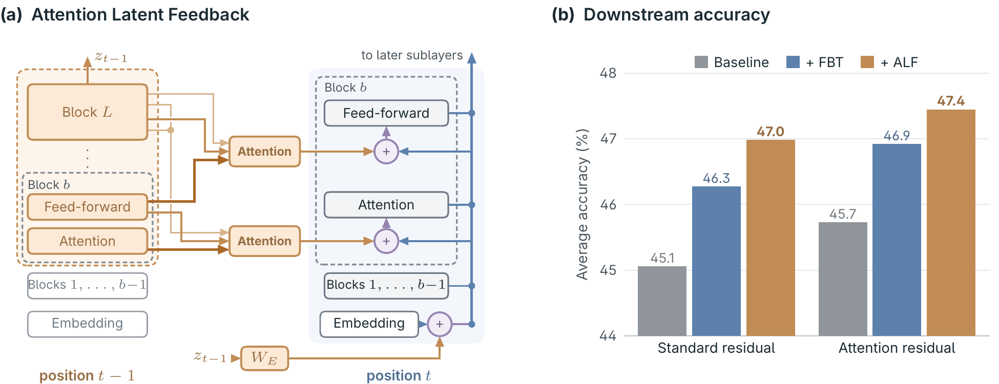

<div align="center">

# Attention Latent Feedback

Xuyuan Xiong<sup>1*</sup>, Siyu Chen<sup>2*</sup>, Mengzhao Chen<sup>1</sup>, Yue Su<sup>1</sup>,<br>
Zhuoran Yang<sup>2</sup>, Ping Luo<sup>1†</sup>, Xihui Liu<sup>1†</sup>

<sup>1</sup>MMLab, The University of Hong Kong · <sup>2</sup>Yale University<br>
<sub>* Equal contribution. † Corresponding authors.</sub>

**[Project Page](https://xjxyys.github.io/attention-latent-feedback/) · [Paper](https://arxiv.org/pdf/2611.31154) · [arXiv](https://arxiv.org/abs/2611.31154)**

**JAX training and evaluation code for Attention Latent Feedback on mixture-of-experts transformers.**

</div>

## Overview

**Let every sublayer attend over the deeper outputs of the previous position: decoding has already computed them, and
standard attention cannot reach them.**

Attention Latent Feedback (ALF) opens two cross-position pathways. Through the **sublayer feedback path**, each output
of the previous position passes once through a per-output low-rank map; every receiving sublayer then applies a learned
depth softmax over the outputs at or above its own depth and mixes the result at a learned share into its input.
Through the **input injection path**, a projection of the previous position's top state is added to the token
embedding. Each sublayer therefore reads every depth once, combining shallower layers from its own position with
deeper layers from the previous one.

<p align="center">
  
</p>

- **Consistent gains across scales and backbones.** ALF lowers held-out loss by 0.024 / 0.023 / 0.022 nats over the
  standard residual across the three model sizes, beats FBT on both backbones under the same schedule, and lifts
  domain-balanced accuracy over seventeen downstream tasks on MoE-4.0B from 45.1% to 47.0%.
- **Cheap at decoding time.** Training unrolls the cross-position recurrence into parallel passes; decoding still runs
  a single pass per token, for 1.1% more per-token FLOPs. The standard model needs 1.38x the training tokens to reach
  ALF's loss.
- **Nearby depths carry most of it.** Replacing the depth softmax with a fixed nearest-4 window keeps 89-94% of the
  gain at linear read cost, while the learned attention widens its margin with scale.
- **Retrofittable.** ALF reads only sublayer inputs and outputs and starts near zero, so it applies to any residual
  backbone and can be switched on late in pretraining without disturbing it.

## Install

Training needs Linux and NVIDIA GPUs; the experiments ran with one JAX process per node on nodes of 8 GPUs, from 1 to
8 nodes. The model, the train step and the scaling-ladder recipe come from
[Marin](https://github.com/marin-community/marin) at a pinned commit, and the environment is Marin's own at that
commit, which installs Marin itself. Execute all commands from the repository root.

```bash
git clone https://github.com/marin-community/marin.git ../marin
git -C ../marin checkout 8577d258214dd0dcb992c04458ee4eb10496d4e5
# Build Marin's environment at that commit, following that commit's own README, then, inside it:
pip install -e '.[data,downstream,dev]'
cp -n .env.example .env                                     # the data / output roots
JAX_PLATFORMS=cpu python tests/test_model.py --skip-d768    # CPU unit tests, no data and no checkpoint
```

The `downstream` extra adds `jinja2`, which the vendored CORE scorer renders its prompts with; the other readouts do
not need it. Tokenization is offline from a local copy of
[`marin-community/marin-tokenizer`](https://huggingface.co/marin-community/marin-tokenizer), whose licence upstream
does not state; `.env.example` lists that path and the rest.

```text
alf/model.py     the model: both backbones, both ALF pathways, FBT's fusion, the pass structure, decoding
alf/trainer.py   training entry: Marin's trainer with the model swapped, branching, gradient accumulation
alf/kinds.py     the models of the paper, as the arguments that rebuild them
alf/rungs.py     the three rungs of the scaling ladder and their schedules
alf/marin/       the Marin glue: recipe, runtime shims, the gradient-accumulation train step
alf/eval/        the two readouts: held-out loss and downstream accuracy
alf/bench/       the downstream suite: building its bundle and the pre-registered readout
alf/vendor/      third-party code carried here, each file with its provenance (see NOTICE)
scripts/         one entry point per task; `--help` on each
tests/           the model against independently written references, plus the suite's own checks
```

The tests check the model against references written out independently of it: one pass and every variant, K = T passes
equal to the exact token-by-token recursion, causality and packing, gradients, the optimizer mask, branching, the
decoding modes, and both pathways. `python tests/test_model.py --help` lists the groups, which can be run one at a
time; without `--skip-d768` it adds the full-width cases on the real GPU kernels.

## Prepare data

All runs train on [`xjxyys/dolma3_hq_300B_shuffled`](https://huggingface.co/datasets/xjxyys/dolma3_hq_300B_shuffled),
a sample of the Allen Institute's Dolma 3 high-quality mix at its official proportions, re-released as 256 parquet
shards under the same ODC-BY licence. It is tokenized into levanter caches with the Marin tokenizer; the held-out
sources are tokenized the same way into `<root>_validation`.

```bash
hf download xjxyys/dolma3_hq_300B_shuffled --repo-type dataset \
  --revision b9d34c9c68d0032a95d20f0322be9ab9e06c4f32 --local-dir ${DOLMA_SRC}
python scripts/prepare_data.py --src ${DOLMA_SRC} --out ${DATA_ROOT}/dolma3 --shards 0-255
python scripts/prepare_data.py --check --out ${DATA_ROOT}/dolma3 --shards 0-255
```

## Train

The three mixture-of-experts rungs, selected with `--shape`. Every block routes each token to 8 of 384 experts plus two
shared experts; activated parameters exclude embeddings, and batch counts sequences of 4,096 tokens.

| `--shape` | model | total | activated | blocks | heads | width | batch | tokens |
|---|---|---|---|---|---|---|---|---|
| `d768` | MoE-1.6B | 1.59B | 61M | 8 | 6 | 768 | 1,024 | 47.9B |
| `d896` | MoE-2.6B | 2.60B | 102M | 10 | 7 | 896 | 1,440 | 80.7B |
| `d1024` | MoE-4.0B | 3.98B | 162M | 12 | 8 | 1,024 | 2,048 | 128.1B |

A run of the paper has two stages: the backbone alone is trained to the branch point at 75% of the rung's schedule, and
each feedback variant then branches from that checkpoint and trains the last quarter.

```bash
D="--shape d768 --data dolma --data-root ${DATA_ROOT}/dolma3 --eval-root ${DATA_ROOT}/dolma3_validation --seed 0"

# the standard residual backbone, to the branch point (8,565 of the 11,420-step rung schedule)
python scripts/train.py --run-name moe_1p6b_plain --variant plain --stop-step 8565 $D

# ALF on it: the sublayer feedback path with the input injection path, for the last quarter
python scripts/train.py --run-name moe_1p6b_alf --kind standard-alf \
  --init-from moe_1p6b_plain --init-step 8565 --allow-partial-checkpoint --passes 2 --eval-passes 3 \
  --embed-inject plain:0.01 --stop-step 11420 $D
```

Every other model of the paper is that second command with a different `--kind`, which
`python scripts/train.py --list-kinds` prints and which expands into the arguments that build it. The
standard-residual FBT baseline also takes `--prefix-mixin --jitter 0.02`, and the one-softmax ablation
(`attnres-alf-joint`) first needs `python scripts/calibrate.py --init-from <base> --init-step N --shape d768
--data-root ${DATA_ROOT}/dolma3 --out biases.json`, then `--feedback-entry-bias biases.json`. The input injection's
constant is `7.68 / width` (0.01 at `d768`), the 1/fan-in scale of a width x width matrix under Adam. For several
nodes, run the same command on each with `--num-processes`, `--process-id` and `--coordinator`; on fewer devices than
a rung assumes, `--microbatches` splits its batch. A relaunch resumes from the newest complete checkpoint.

> A branch needs `--allow-partial-checkpoint`, since it adds parameters its base does not carry. That flag restores
> every leaf the checkpoint has and takes the rest from the initialization, and ALF's parameters are zero-initialized
> by design, so arguments that do not match the base are **not** an error: the pathway loads as zeros and the branch
> trains the backbone alone, at a loss that looks reasonable. The check is the first step's pass-1 loss, which should
> match the base run's last step.

A smoke test takes a few minutes on one GPU, with no data and no checkpoint of your own:

```bash
python scripts/train.py --run-name smoke --kind standard-alf --proj-rank 16 \
  --shape d768 --layers 2 --batch 8 --schedule-steps 20 --stop-step 3 --save-every 2 \
  --passes 2 --eval-passes 2 --data synthetic
```

## Evaluate

The paper's two readouts. Both take models as `<run>:<kind>`, resolve each run's newest complete checkpoint and skip a
model whose output is already there, so an interrupted run is resumed by repeating the command.

**Held-out loss** is the main table: bits per byte and loss on the held-out sources, at each Jacobi pass count.

```bash
M=moe_1p6b_alf:standard-alf,moe_1p6b_fbt:standard-fbt
python scripts/eval_heldout.py --models $M --shape d768 --passes 1,2,3,4 --out-dir ${OUTPUT_ROOT}/heldout
```

**Downstream accuracy** is the 20 tasks of [Schwethelm et al.](https://arxiv.org/abs/2604.21106) plus 6 from
[CORE](https://arxiv.org/abs/2406.11794), built from pinned public sources into a bundle that records the revision and
SHA-256 of every task, so it can be rebuilt byte for byte. One model at a time, sharded over the GPUs.

```bash
B=${OUTPUT_ROOT}/bench
python scripts/prepare_bench.py --dest ${DATA_ROOT}/bench     # needs network access, once
JAX_PLATFORMS=cpu python tests/test_bench.py --bundle ${DATA_ROOT}/bench   # the suite's packing and readout, no model
python scripts/eval_bench.py --models $M --shape d768 --passes 3 --gpus 8 --out-dir $B
# the reference model's earlier checkpoint, which the accuracy screen below reads through --traj
python scripts/eval_bench.py --models moe_1p6b_attnres:attnres --shape d768 --passes 3 --step 2000 --gpus 8 --out-dir $B
python scripts/read_bench.py --main alf --reference attnres --out $B/readout.json \
  --model standard=$B/moe_1p6b_plain_s11420 --model attnres=$B/moe_1p6b_attnres_s11420 \
  --model fbt=$B/moe_1p6b_fbt_s11420 \
  --model alf-s0=$B/moe_1p6b_alf_s0_s11420 --model alf-s1=$B/moe_1p6b_alf_s1_s11420 \
  --average alf=alf-s0,alf-s1 --null alf-s0,alf-s1 --traj attnres=$B/moe_1p6b_attnres_s2000
```

The readout reports the loss over all tasks, the accuracy over the tasks where accuracy carries signal (decided on the
reference model alone, against its own earlier checkpoint and against chance), the paired differences with a bootstrap
interval, and the same difference between two seeds of one model as a noise floor. With fewer models, pass fewer
`--model` arguments.

Of the paper's Section 6, the train-inference gap, the source knockout and the depth maps are not in this repository;
the decoding modes are reachable through `scripts/eval_bench.py --decode` and the fixed-window depth rule through the
`standard-nearest4` kind.

## License and acknowledgments

The code is released under the [MIT License](LICENSE); [NOTICE](NOTICE) lists the third-party material. The CORE
prompt rendering and batching in [`alf/vendor/`](alf/vendor) is from
[`karpathy/nanochat`](https://github.com/karpathy/nanochat) (MIT), and the downstream task builders beside it are
adapted from [`kschwethelm/looped-lm-scaling`](https://github.com/kschwethelm/looped-lm-scaling) (MIT). Marin and
levanter are used as separate checkouts under their own licenses and are not distributed here. The backbone, the recipe
and the scaling ladder follow [Marin](https://github.com/marin-community/marin); the attention-residual backbone
follows [Attention Residuals](https://arxiv.org/abs/2603.15031); the fusion baseline is
[FBT](https://arxiv.org/abs/2608.08888); the input injection follows Recycler and
[LoRM](https://github.com/ifm-ai/LoRM). We thank the authors for releasing their code.

## Citation

If you find this work useful, please cite:

```bibtex
@misc{xiong2026alf,
  title         = {{Attention Latent Feedback}},
  author        = {Xuyuan Xiong and Siyu Chen and Mengzhao Chen and Yue Su and Zhuoran Yang and Ping Luo and Xihui Liu},
  year          = {2026},
  eprint        = {2611.31154},
  archivePrefix = {arXiv},
  primaryClass  = {cs.LG},
  url           = {https://arxiv.org/abs/2611.31154}
}
```
